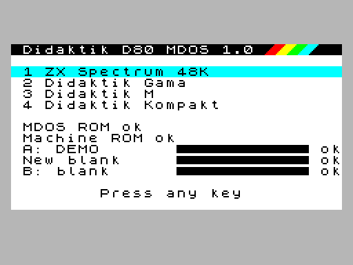
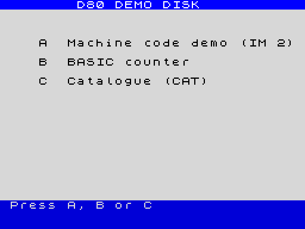
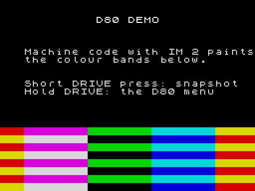
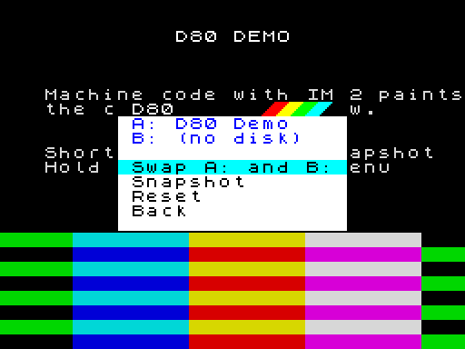
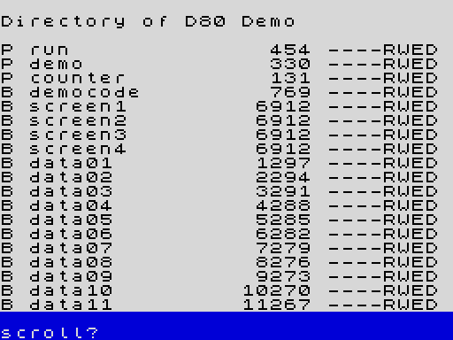

# Didaktik D40/D80 disk images on the ZX Spectrum Next

My first computer was a Czechoslovak Didaktik Gama, later with a 5.25" disk drive, the D40. When I started playing with the ZX Spectrum Next, I found there was no simple way to run those disk images on it. So I created this project: a simple dot command that opens those images on the ZX Spectrum Next.

I made it for fun, to learn more about the ZX Spectrum Next, and to practise prompting, agentic AI development and collaboration with AI.

**`.d80`** boots Didaktik D40/D80 (MDOS) disk images (`.d40`/`.d80`) on the ZX Spectrum Next with the real MDOS 1.0. The Next becomes a 48K Spectrum with a Didaktik 80, so disk menus, multi-load games and `CAT`/`LOAD *`/`RUN` work as on the original. You can also open images straight from the NextZXOS browser.

## Screenshots

All screens show the demo disk `dist/d80/demo.d80`, which is generated by `tools/demo_image.py`.

| Starting `.d80 demo.d80 -n blank.d80`, before MDOS takes over |
|---|
|  |

| Disk menu after `RUN` | Machine code demo (IM 2) loaded from disk |
|---|---|
|  |  |
| **D80 menu (hold the DRIVE button)** | **`CAT`** |
|  |  |

<sub>The start screen was captured in ZEsarUX (TBBlue/Next) with `tools/zesarux_next_check.py`. The other screens were rendered with the project's Python model of `.d80` (`tools/preview_d80.py`), running the real MDOS 1.0 and 48K ROM.</sub>

## Features

- Runs `.d40` and `.d80` images with the original MDOS 1.0 and 48K ROM
- Optionally saves disk changes back to the image file on the SD card
- Two drives (A: and B:) and creation of blank disks
- The Next's DRIVE button works as the Didaktik SNAP button and opens a small disk menu

## Installation

1. Copy the contents of `dist/` to the root of your Next SD card.
2. Download the MDOS 1.0 ROM `Didaktik_40-80_MDOS_v1_91.rom` (MDOS 1.0, 1991) from [cygnus.speccy.cz](https://cygnus.speccy.cz/download_roms.php) and save it as `/sys/d80/mdos10.rom`. The ROM is copyrighted and is not included.

## Usage

```
.d80 /d80/demo.d80             ; boot an image, then RUN, CAT, LOAD *"name" ...
.d80 -w /d80/demo.d80          ; also save disk changes to the image file
.d80 -w -n /d80/new.d80        ; create a blank disk and use it
.d80 -w game.d80 data.d80      ; second image in drive B:
```

To open images from the NextZXOS browser, add the lines from `dist/browser-d80.cfg` to the end of `/nextzxos/browser.cfg`.

Leave with a hard reset.

## Documentation

- [Usage guide](docs/usage.md) — all options, browser setup, SNAP button, limits, troubleshooting
- [Development](docs/development.md) — building, how it works, tools, tests
- [Disk format](docs/disk-format.md) — MDOS image and snapshot format

## Limits

48K mode and MDOS 1.0 only, at most two drives. See the [usage guide](docs/usage.md#limits) for details.
